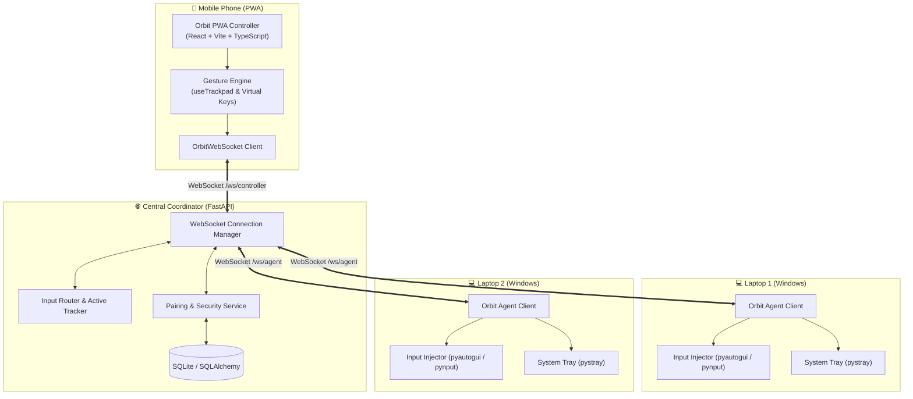

# 🪐 Orbit — Universal Multi-Laptop Remote Control

> Turn your phone into a low-latency universal trackpad, keyboard, and virtual workstation controller for multiple laptops simultaneously.

Orbit makes multiple physical computers feel like a single continuous virtual workspace. Arrange your laptops on a 2D canvas, move the pointer seamlessly between screens, send keystrokes, trigger multi-touch gestures, and manage displays from any mobile phone running modern web standards (PWA).

---

## 🌟 Key Features

- **📱 Mobile-First PWA Controller**: No app store install needed. Works immediately in Safari, Chrome, Edge, and Firefox on iOS and Android.
- **⚡ Ultra-Low Latency WebSocket Pipeline**: Sub-10ms input routing over local Wi-Fi or secure tunneling.
- **🖥️ Multi-Laptop Display Arranger**: Visual drag-and-drop 2D layout editor (similar to Windows Display Settings) that maps relative positions of your laptops.
- **🔄 Seamless Virtual Workspace Navigation**: Switch between laptops instantaneously from the quick bar or navigate through arranged screen borders.
- **🖱️ Precision Touch Trackpad**:
  - 1-finger relative movement with optional acceleration
  - 1-finger tap to left-click
  - 2-finger tap to right-click
  - 2-finger vertical scroll (with natural reverse scrolling toggle)
  - Tap-and-hold drag & drop
  - Dedicated Left / Middle / Right physical mouse buttons
- **⌨️ Hardware & Virtual Keyboard Support**: Native mobile input bridge, modifier keys (Ctrl, Alt, Shift, Win) with latch/lock modes, Function keys (F1–F12), and power shortcuts (Alt+Tab, Win+D, Ctrl+C, Ctrl+V).
- **🔒 Zero-Friction Secure Pairing**: 6-digit cryptographic pairing code with automatic mutual authentication and Windows Credential Manager storage.
- **📦 Zero-Config Windows Agent**: Lightweight standalone Windows executable (`orbit-agent.exe`) with system tray controls, display detection, and failsafe input release.

---

## 🏗️ Architecture Overview



---

## 📁 Repository Structure

```
Orbit/
├── agent/                      # Windows background agent (Python / PyInstaller)
│   ├── orbit_agent/
│   │   ├── configuration/      # AppData & Credential Manager storage
│   │   ├── diagnostics/        # Rotating file & console logging
│   │   ├── display/            # Screen resolution & monitor metrics
│   │   ├── input/              # Windows mouse & keyboard event injection
│   │   ├── networking/         # Reconnecting WebSocket client
│   │   └── tray/               # System tray icon & menu
│   ├── scripts/
│   │   └── build_exe.py        # PyInstaller standalone EXE builder
│   └── requirements.txt
├── backend/                    # Central Coordinator service (FastAPI)
│   ├── app/
│   │   ├── api/                # REST (devices, pairing, layout) & WebSocket endpoints
│   │   ├── connections/        # Connection registry & broadcast engine
│   │   ├── core/               # Security, tokens, settings
│   │   ├── database/           # SQLite async engine & models
│   │   └── models/             # Device, PairingCode, Layout models
│   ├── migrations/             # Alembic database migration scripts
│   └── requirements.txt
├── frontend/                   # Mobile-first PWA controller (React 18 + Vite)
│   ├── public/                 # PWA icons, manifest.json
│   ├── src/
│   │   ├── components/         # AppShell, QuickSwitch, StatusBars
│   │   ├── hooks/              # useTrackpad, gesture recognition
│   │   ├── pages/              # Trackpad, Keyboard, Devices, Layout, Pairing, Settings
│   │   ├── services/           # Reconnecting WebSocket abstraction
│   │   └── store/              # Global OrbitContext & state reducer
│   └── package.json
├── protocol/                   # Shared protocol definitions & documentation
│   ├── documentation/          # protocol.md
│   └── schemas/                # messages.py (Pydantic v2 schemas)
├── docs/                       # Architectural & setup guides
└── scripts/                    # Convenience launch scripts
```

---

## 🚀 Quick Start Guide

### 1. Prerequisites
- **Python**: 3.10+
- **Node.js**: 18+
- **Windows**: 10 or 11 (for the agent)

---

### 2. Run the Coordinator Backend

```bash
cd backend
python -m venv .venv
# Windows:
.venv\Scripts\activate
# Linux/macOS:
source .venv/bin/activate

pip install -r requirements.txt
uvicorn app.main:app --host 0.0.0.0 --port 8000 --reload
```
The coordinator API will start at `http://0.0.0.0:8000` with Swagger documentation at `http://localhost:8000/docs`.

---

### 3. Run the PWA Mobile Controller

```bash
cd frontend
npm install
npm run dev -- --host 0.0.0.0
```
Open your mobile browser (or desktop browser in mobile responsive mode) at `http://<YOUR_COMPUTER_LOCAL_IP>:5173`.
Tap **"Install"** or **"Add to Home Screen"** to run Orbit in full-screen PWA mode!

---

### 4. Run the Windows Agent

On each laptop you wish to control:

```bash
cd agent
python -m venv .venv
.venv\Scripts\activate
pip install -r requirements.txt
python -m orbit_agent
```

On first run, the agent will prompt for the backend URL (e.g., `http://192.168.1.50:8000`). It will request a pairing code, which you approve directly from the mobile PWA controller under **"Pairing"**.

To build a standalone single-file Windows executable:
```bash
cd agent
python scripts/build_exe.py
# Output generated at: dist/orbit-agent.exe
```

---

## 🔒 Security Model

- **Device Authentication**: Each paired laptop receives a unique cryptographic `device_secret` hashed with SHA-256 and stored on the device via Windows Credential Manager.
- **Short-Lived Pairing Codes**: Time-limited 6-digit codes (120-second expiry) prevent unauthorized agent joins.
- **Failsafe Release**: If WebSocket disconnection occurs or an agent exits unexpectedly, all pressed keys and mouse buttons are automatically released to prevent stuck inputs.

---

## 🧪 Testing

```bash
# Run backend tests
cd backend
pytest

# Run frontend tests
cd frontend
npm test

# Run agent tests
cd agent
pytest
```

---

## 📜 License
MIT License. Built with precision for seamless multi-device productivity.