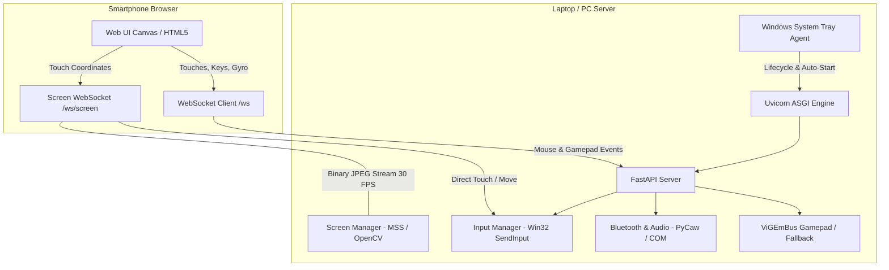

# 🏗️ Architecture & Protocols

OmniControl is designed for sub-10 millisecond response times and low resource utilization.

---

## 📐 Architecture Diagram



---

## 📡 WebSocket Protocols

### 1. Main Control WebSocket (`/ws`)

Connects at `ws://<host>:<port>/ws` or `wss://<host>:<port>/ws`.
All control packets are JSON-encoded strings:

#### Mouse Move:
```json
{
  "type": "mouse_move",
  "dx": 2.5,
  "dy": -1.2,
  "accel": 1.5
}
```

#### Mouse Click / Button:
```json
{
  "type": "mouse_button",
  "button": "left",
  "action": "click"
}
```
*(Actions: `click`, `dblclick`, `down`, `up` | Buttons: `left`, `right`, `middle`)*

#### Direct Touch on Screen:
```json
{
  "type": "screen_touch",
  "action": "click",
  "x": 0.452,
  "y": 0.812,
  "button": "left"
}
```
*(Normalized coordinates `0.0` to `1.0`)*

#### Gamepad Stick:
```json
{
  "type": "controller_stick",
  "stick": "left",
  "x": -0.85,
  "y": 0.62
}
```

#### Latency Heartbeat Ping / Pong:
```json
{"type": "ping", "t": 1729000000000}
```
Server responds:
```json
{"type": "pong", "t": 1729000000000}
```

---

### 2. Screen Streaming WebSocket (`/ws/screen`)

Dedicated binary WebSocket for zero-overhead frame delivery:
- **Server to Client**: Raw binary JPEG image buffer (`ArrayBuffer` / `Blob`).
- **Client to Server**: JSON control messages:
  - `{"type": "config", "fps": 25, "scale": 0.75, "quality": 55}`
  - `{"type": "touch", "action": "click", "x": 0.5, "y": 0.5, "button": "left"}`
  - `{"type": "mouse_scroll", "dx": 0, "dy": 5}`
  - `{"type": "key", "key": "esc", "action": "tap"}`
  - `{"type": "type_text", "text": "Hello world"}`

---

## 🌐 REST API Endpoints

| Method | Endpoint | Description |
| :--- | :--- | :--- |
| `GET` | `/` | Serves mobile web application (`index.html`) |
| `GET` | `/api/status` | Hostname, LAN IP, screen resolution, audio, controller status |
| `GET` | `/api/startup` | Check if Windows startup registration is enabled |
| `POST` | `/api/startup` | Set startup registration `{"enabled": true/false}` |
| `GET` | `/api/screen/snapshot` | Single JPEG snapshot of the laptop screen |
| `GET` | `/api/screen/stream.mjpg` | Standard MJPEG video stream (universal browser fallback) |
| `GET` | `/api/devices` | List paired Bluetooth and audio endpoint devices |
| `POST` | `/api/audio/volume` | Set volume `{"level": 0-100}` |
| `POST` | `/api/audio/mute` | Toggle audio mute |
| `POST` | `/api/media` | Media action `{"action": "playpause" | "next" | "prev"}` |
| `POST` | `/api/controller/retry` | Re-attempt ViGEmBus driver initialization |
